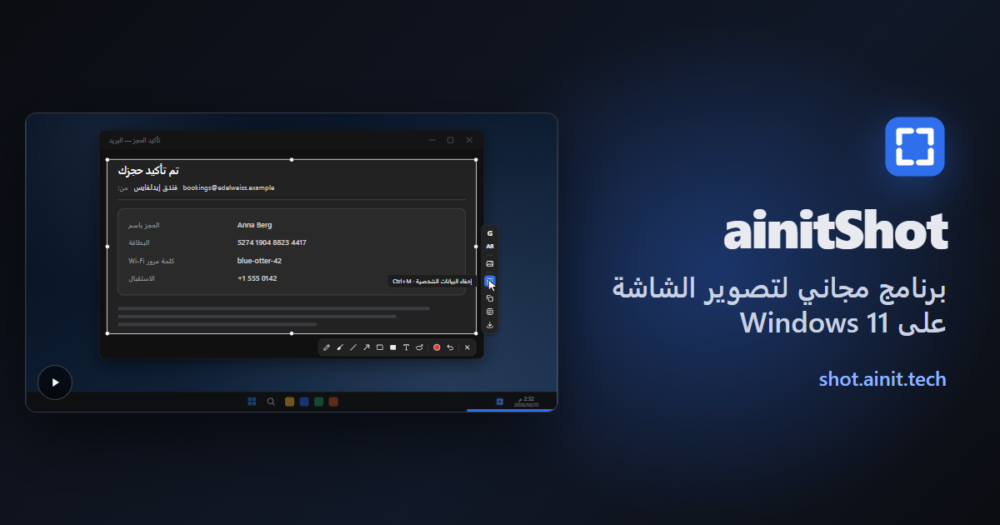

[English](README.md) · [Русский](README.ru.md) · [中文](README.zh.md) · [Español](README.es.md) · [Français](README.fr.md) · **العربية**

# ‏ainitShot

برنامج مجاني ومفتوح المصدر لالتقاط لقطات الشاشة في Windows. مفتاح واحد يجمّد الشاشة: خذ نافذة أو أي جزء منها، وارسم عليها، وأخفِ ما هو خاص، ثم انسخ اللقطة أو نصها، أو احفظها، أو اسأل الذكاء الاصطناعي من Google عنها.

**[تنزيل لـ Windows](https://shot.ainit.tech/ar/get)** · [الموقع](https://shot.ainit.tech/ar) · [التوثيق (بالإنجليزية)](docs/en/README.md)

## ماذا يفعل

- **اسأل الذكاء الاصطناعي من Google عن اللقطة** — <kbd>G</kbd>. يخبرك وضع الذكاء الاصطناعي مَن أو ما الذي في الصورة، وتُفتح المحادثة بجانب التحديد لتواصل السؤال. ودائرة بالقلم السحري تُري الذكاء الاصطناعي أين ينظر.
- **اسأل بصوتك** — اضغط <kbd>G</kbd> باستمرار، وقل سؤالك، ثم اتركه: يُرسَل مع الصورة.
- **ترجم ما تراه** — <kbd>T</kbd>. تظهر الترجمة وحدها، بلغتك، في بطاقة بجانب التحديد.
- **ابحث بالصورة** — <kbd>I</kbd>. تجد صور Google من أين جاءت الصورة وأين توجد أيضًا، والتطابقات التامة أولًا.
- **أخفِ البيانات الشخصية** — <kbd>Ctrl</kbd>+<kbd>M</kbd>. تُغطّى فورًا المفاتيح وكلمات المرور وأرقام البطاقات والحسابات وعناوين البريد الإلكتروني وأرقام الهواتف وعناوين IP؛ ويجد OpenAI Privacy Filter، وهو نموذج يعمل على حاسوبك، الأسماءَ والعناوين والتواريخ والروابط أيضًا. لا تغادر اللقطة حاسوبك من أجل ذلك.
- **انسخ النص من الصورة** — <kbd>Ctrl</kbd>+<kbd>Shift</kbd>+<kbd>C</kbd>. يقرؤه التعرّف على النص المدمج في Windows على حاسوبك ويضعه في الحافظة.
- **القلم السحري** — <kbd>M</kbd>. ضع دائرة تقريبية حول أي شيء، فتحصل على شكل بيضوي أو مستطيل مرتب.
- **وكل أدوات الرسم المعتادة:** قلم الرصاص والفرشاة والخط والسهم والمستطيل والمستطيل الممتلئ والنص، ولكلٍّ منها مفتاحه. يمكن لاحقًا تحريك كل ما رُسم أو تغيير شكله أو إعادة كتابته، و<kbd>Ctrl</kbd>+<kbd>Z</kbd> يتراجع عن أي تغيير.
- **انسخ أو احفظ** — <kbd>Ctrl</kbd>+<kbd>C</kbd> يضع اللقطة في الحافظة، و<kbd>Ctrl</kbd>+<kbd>S</kbd> يحفظها ملفَّ PNG في «الصور\لقطات الشاشة».

## لقطتك تبقى لك

- **على حاسوبك:** الرسم وإخفاء البيانات ونسخ النص. لا ترسل شيئًا إلى أي مكان. يُنزَّل نموذج الإخفاء، نحو 950 ميغابايت، مرة واحدة وحده في الخلفية؛ وإلى أن يكتمل، يجد الإخفاء كل شيء ما عدا الأسماء والعناوين والتواريخ والروابط.
- **إلى Google، فقط عندما تطلب:** لا تذهب اللقطة إلى وضع الذكاء الاصطناعي من Google أو إلى صور Google إلا بـ <kbd>G</kbd> أو <kbd>T</kbd> أو <kbd>I</kbd>، في نافذة البرنامج نفسه، كما من أي متصفح. وإذا سألت بصوتك، يذهب صوتك أيضًا إلى التعرّف على الكلام من Google؛ ولا يعمل الميكروفون إلا ما دام المفتاح مضغوطًا. ولكي يجيب فورًا، يُبقي البرنامج وضع الذكاء الاصطناعي محمّلًا في نافذته المخفية؛ ولا تصل لقطتك إليه إلا عندما تسأل.
- **بلا حسابات ولا سحابة خاصة بنا.** تسجيل الدخول إلى Google في نافذة البرنامج أمر يعود إليك: عندها يسألك Google أقل إن كنت روبوتًا، ويحفظ وضع الذكاء الاصطناعي محادثاتك. والخادم الوحيد التابع لنا الذي يتصل به البرنامج هو shot.ainit.tech، للتحديثات، وهي تصل موقّعة.

## وأيضًا

- **مفتاح PrtSc** أو مفاتيحك الخاصة، تختارها عند أول تشغيل؛ ويقترح البرنامج <kbd>Alt</kbd> مع المفتاح الذي على يسار <kbd>1</kbd>، لالتقاط الشاشة باليد اليسرى وحدها. وإذا ضغطت المفتاح مرة أخرى والشاشة مجمّدة، تختار من جديد.
- **50 لغة**: لغات الأمم المتحدة الست و44 لغة أخرى، تختار منها عند أول تشغيل، ولكل لغة مربع وعلم.
- **الإعدادات في نافذة واحدة فيها بحث**، وفي ملف نصي بتعليقات يمكنك تعديله يدويًا. ويمكنك تغيير أزرار الاستعلام وأسئلتها ومفاتيحها.
- مكتوب بلغة Rust، وينتظر المفتاح في الخلفية. لـ Windows 11 بنظام 64 بت؛ ولم يُجرَّب على Windows 10.

## الترخيص والاسم والشعار

إن ainitShot برنامج حر بموجب رخصة جنو العمومية العامة، الإصدار 3 أو أي إصدار لاحق ([LICENSE](LICENSE)): يمكنك استخدامه ودراسته وتعديله ونقله إلى غيرك. لا تشمل الرخصةُ الاسمَ ainitShot ولا شعاره: أي نسخة مشتقة (fork)، أو أي نسخة معدّلة تنقلها إلى غيرك، تحمل اسمًا آخر وشعارًا آخر، كي لا يظنها أحد ainitShot.

## الإبلاغ عن مشكلة

- **خطأ برمجي:** افتح issue على https://github.com/ainit-tech/shot/issues. صف ما فعلته، وما كنت تتوقعه، وما حدث بدلًا منه، واذكر إصدار البرنامج (الإعدادات ← حول) وإصدار Windows لديك. لقطة الشاشة تساعد؛ تأكد من أنها لا تحوي شيئًا خاصًا.
- **ثغرة أمنية:** لا تصفها في issue، حيث يقرؤها الجميع. افتح issue بعنوان «Security contact» دون أي تفاصيل، وسنتفق معك على طريقة خاصة لإرسالها.

## ما الذي نقبله

- البلاغات عن الأخطاء.
- تصحيحات الترجمة: كلمة خاطئة أو ركيكة في أي من اللغات الخمسين، في issue أو كطلب سحب (pull request) إلى `src/locales/<code>.json`. معظم الترجمات آلية، ولم يقرأها متحدثون أصليون بعد.

التعديلات على الشفرة لاحقًا: لا نقبلها بعد.

## أين يجري التطوير

يجري التطوير على SourceCraft ([sourcecraft.dev/ainit-tech/shot](https://sourcecraft.dev/ainit-tech/shot))؛ وهذا المستودع على GitHub مرآة له، والـ issues مرحَّب بها هنا أيضًا.

