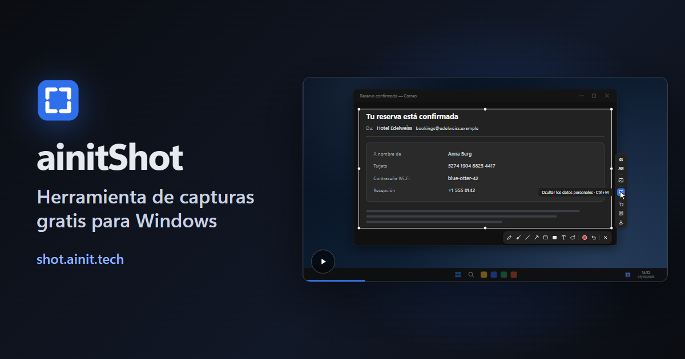

[English](README.md) · [Русский](README.ru.md) · [中文](README.zh.md) · **Español** · [Français](README.fr.md) · [العربية](README.ar.md)

# ainitShot

Un programa de capturas de pantalla para Windows, gratuito y de código abierto. Una tecla congela la pantalla: toma una ventana o cualquier parte de ella, dibuja encima, oculta lo privado y luego copia la captura o su texto, guárdala o pregúntale por ella a la IA de Google.

**[Descargar para Windows](https://shot.ainit.tech/es/get)** · [Sitio web](https://shot.ainit.tech/es) · [Documentación (en inglés)](docs/en/README.md)

## Qué hace

- **Pregúntale a la IA de Google por la captura** — <kbd>G</kbd>. El Modo IA te dice quién o qué aparece en la imagen, y la conversación se abre junto a la selección para seguir preguntando. Un lazo del lápiz mágico le muestra a la IA dónde mirar.
- **Pregunta en voz alta** — mantén pulsada la <kbd>G</kbd>, di tu pregunta y suéltala: se envía junto con la imagen.
- **Traduce lo que ves** — <kbd>T</kbd>. Solo la traducción aparece, en tu idioma, en una tarjeta junto a la selección.
- **Busca por imagen** — <kbd>I</kbd>. Google Imágenes encuentra de dónde viene la imagen y dónde más aparece, primero las coincidencias exactas.
- **Oculta los datos personales** — <kbd>Ctrl</kbd>+<kbd>M</kbd>. Claves, contraseñas, números de tarjeta y de cuenta, direcciones de correo, teléfonos y direcciones IP se tapan al instante; OpenAI Privacy Filter, un modelo que se ejecuta en tu ordenador, encuentra además nombres, direcciones, fechas y enlaces. La captura no sale de tu ordenador para esto.
- **Copia el texto de la imagen** — <kbd>Ctrl</kbd>+<kbd>Shift</kbd>+<kbd>C</kbd>. El reconocimiento de texto integrado en Windows lo lee en tu ordenador y lo pone en el portapapeles.
- **Lápiz mágico** — <kbd>M</kbd>. Rodea algo sin cuidado y obtén un óvalo o un rectángulo limpios.
- **Y todas las herramientas de dibujo de siempre:** lápiz, pincel, línea, flecha, rectángulo, rectángulo relleno y texto, cada una con su propia tecla. Todo lo dibujado se puede mover, cambiar de forma o reescribir después, y <kbd>Ctrl</kbd>+<kbd>Z</kbd> deshace cualquier cambio.
- **Copia o guarda** — <kbd>Ctrl</kbd>+<kbd>C</kbd> pone la captura en el portapapeles, <kbd>Ctrl</kbd>+<kbd>S</kbd> la guarda como archivo PNG en Imágenes\Capturas de pantalla.

## Tu captura sigue siendo tuya

- **En tu ordenador:** dibujar, ocultar los datos y copiar el texto. No envían nada a ninguna parte. El modelo para ocultar los datos, de unos 950 MB, se descarga una sola vez, por sí solo y en segundo plano; mientras tanto, se encuentra todo menos nombres, direcciones, fechas y enlaces.
- **A Google, solo cuando lo pides:** la captura va al Modo IA de Google o a Google Imágenes solo con <kbd>G</kbd>, <kbd>T</kbd> o <kbd>I</kbd>, en la propia ventana del programa, como desde un navegador. Si preguntas en voz alta, tu voz va también al reconocimiento de voz de Google; el micrófono solo está encendido mientras mantienes pulsada la tecla. Para responder al instante, el programa tiene el Modo IA ya cargado en su ventana oculta; tu captura solo llega allí cuando preguntas.
- **Sin cuentas y sin nube nuestra.** Iniciar sesión en Google en la ventana del programa es cosa tuya: así Google pregunta menos a menudo si eres un robot, y el Modo IA guarda tus conversaciones. El único servidor nuestro con el que habla el programa es shot.ainit.tech, para las actualizaciones, que llegan firmadas.

## Y además

- **Impr Pant**, o tus propias teclas, elegidas en el primer inicio; el programa sugiere <kbd>Alt</kbd> con la tecla a la izquierda del <kbd>1</kbd>, para capturar con la mano izquierda sola. Si la pulsas otra vez con la pantalla congelada, vuelves a elegir.
- **50 idiomas**, los seis de la ONU y 44 más, para elegir en el primer inicio, con un recuadro y una bandera para cada uno.
- **Los ajustes en una sola ventana con búsqueda**, y en un archivo de texto con comentarios que puedes editar a mano. Los botones de consulta, sus preguntas y sus teclas se pueden cambiar.
- Escrito en Rust; espera la tecla en segundo plano. Para Windows 11 de 64 bits; no se ha probado en Windows 10.

## Licencia, nombre y logotipo

ainitShot es software libre bajo la Licencia Pública General de GNU, versión 3 o posterior ([LICENSE](LICENSE)): puedes usarlo, estudiarlo, modificarlo y compartirlo. El nombre ainitShot y su logotipo no están cubiertos por la licencia: un fork, o cualquier versión modificada que compartas, lleva otro nombre y otro logotipo, para que nadie la confunda con ainitShot.

## Informar de un problema

- **Un error:** abre una issue en https://github.com/ainit-tech/shot/issues. Cuenta qué hiciste, qué esperabas y qué pasó en su lugar, e indica la versión del programa (Ajustes → Acerca de) y tu versión de Windows. Una captura ayuda; asegúrate de que no se vea nada privado en ella.
- **Una vulnerabilidad:** no la describas en una issue, donde todos pueden leerla. Abre una issue titulada «Security contact» sin ningún detalle, y acordaremos contigo una forma privada de enviarlos.

## Qué aceptamos

- Informes de errores.
- Correcciones de traducciones: una palabra equivocada o torpe en cualquiera de los 50 idiomas, en una issue o como pull request a `src/locales/<código>.json`. La mayoría de las traducciones son automáticas y aún no las han leído hablantes nativos.

Los cambios en el código vendrán más adelante: por ahora no los aceptamos.

## Dónde se desarrolla

El desarrollo se hace en SourceCraft ([sourcecraft.dev/ainit-tech/shot](https://sourcecraft.dev/ainit-tech/shot)); este repositorio de GitHub es su espejo, y aquí también son bienvenidas las issues.
