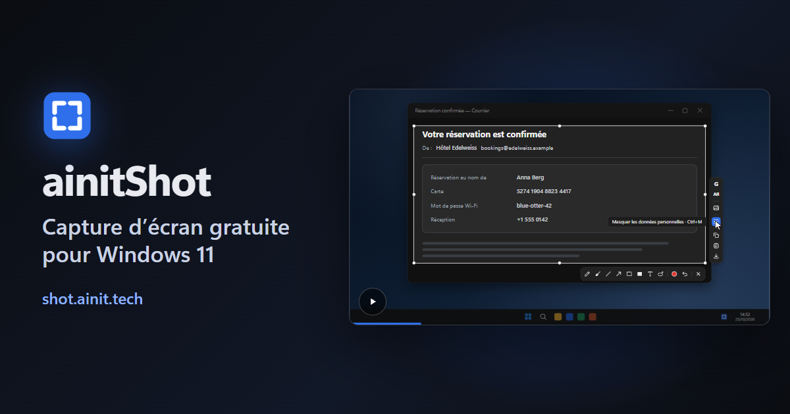

[English](README.md) · [Русский](README.ru.md) · [中文](README.zh.md) · [Español](README.es.md) · **Français** · [العربية](README.ar.md)

# ainitShot

Un logiciel de capture d’écran pour Windows, gratuit et open source. Une touche fige l’écran : prenez une fenêtre ou n’importe quelle partie de l’écran, dessinez dessus, masquez ce qui est privé, puis copiez la capture ou son texte, enregistrez-la ou interrogez l’IA de Google à son sujet.

**[Télécharger pour Windows](https://shot.ainit.tech/fr/get)** · [Site](https://shot.ainit.tech/fr) · [Documentation (en anglais)](docs/en/README.md)

## Ce qu’il fait

- **Interroger l’IA de Google sur la capture** — <kbd>G</kbd>. Le Mode IA dit qui ou quoi se trouve sur l’image, et la conversation s’ouvre à côté de la sélection pour poser d’autres questions. Une boucle du crayon magique montre à l’IA où regarder.
- **Demander à voix haute** — maintenez <kbd>G</kbd>, posez votre question et relâchez : elle part avec l’image.
- **Traduire ce que vous voyez** — <kbd>T</kbd>. Seule la traduction s’affiche, dans votre langue, dans une carte à côté de la sélection.
- **Rechercher par image** — <kbd>I</kbd>. Google Images trouve d’où vient l’image et où elle apparaît encore, les correspondances exactes d’abord.
- **Masquer les données personnelles** — <kbd>Ctrl</kbd>+<kbd>M</kbd>. Clés, mots de passe, numéros de carte et de compte, adresses e-mail, numéros de téléphone et adresses IP sont couverts aussitôt ; OpenAI Privacy Filter, un modèle qui tourne sur votre ordinateur, trouve aussi les noms, adresses, dates et liens. La capture ne quitte pas votre ordinateur pour cela.
- **Copier le texte de l’image** — <kbd>Ctrl</kbd>+<kbd>Shift</kbd>+<kbd>C</kbd>. La reconnaissance de texte intégrée à Windows le lit sur votre ordinateur et le met dans le presse-papiers.
- **Crayon magique** — <kbd>M</kbd>. Entourez grossièrement quelque chose, vous obtenez un ovale ou un rectangle net.
- **Et tous les outils de dessin habituels :** crayon, pinceau, ligne, flèche, rectangle, rectangle plein et texte, chacun sur sa propre touche. Tout ce qui est dessiné peut ensuite être déplacé, remodelé ou réécrit, et <kbd>Ctrl</kbd>+<kbd>Z</kbd> annule n’importe quelle modification.
- **Copier ou enregistrer** — <kbd>Ctrl</kbd>+<kbd>C</kbd> met la capture dans le presse-papiers, <kbd>Ctrl</kbd>+<kbd>S</kbd> l’enregistre en fichier PNG dans Images\Captures d’écran.

## Votre capture reste la vôtre

- **Sur votre ordinateur :** le dessin, le masquage et la copie du texte. Ils n’envoient rien nulle part. Le modèle de masquage, environ 950 Mo, se télécharge une seule fois, tout seul, en arrière-plan ; en attendant, le masquage trouve tout sauf les noms, adresses, dates et liens.
- **Vers Google, seulement quand vous le demandez :** la capture part vers le Mode IA de Google ou Google Images uniquement avec <kbd>G</kbd>, <kbd>T</kbd> ou <kbd>I</kbd>, dans la propre fenêtre du programme, comme depuis un navigateur. Si vous demandez à voix haute, votre voix part aussi vers la reconnaissance vocale de Google ; le micro n’est allumé que tant que la touche est maintenue. Pour répondre aussitôt, le programme garde le Mode IA chargé dans sa fenêtre cachée ; votre capture n’y arrive que lorsque vous demandez.
- **Ni compte ni cloud à nous.** Vous connecter à Google dans la fenêtre du programme reste votre choix : Google vous demande alors moins souvent si vous êtes un robot, et le Mode IA garde vos conversations. Le seul serveur à nous que le programme contacte est shot.ainit.tech, pour les mises à jour, qui arrivent signées.

## Et aussi

- **Impr. écran**, ou vos propres touches, choisies au premier lancement ; le programme propose <kbd>Alt</kbd> avec la touche à gauche du <kbd>1</kbd>, pour une capture de la seule main gauche. Pressée de nouveau pendant que l’écran est figé, la touche recommence la sélection.
- **50 langues**, les six de l’ONU et 44 autres, à choisir au premier lancement, avec une tuile et un drapeau pour chacune.
- **Les réglages dans une seule fenêtre avec une recherche**, et dans un fichier texte commenté que l’on peut modifier à la main. Les boutons de requête, leurs questions et leurs touches se modifient à votre guise.
- Écrit en Rust ; il attend la touche en arrière-plan. Pour Windows 11, 64 bits ; il n’a pas été essayé sous Windows 10.

## Licence, nom et logo

ainitShot est un logiciel libre sous la Licence publique générale GNU, version 3 ou ultérieure ([LICENSE](LICENSE)) : vous pouvez l’utiliser, l’étudier, le modifier et le transmettre. Le nom ainitShot et son logo ne sont pas couverts par la licence : un fork, ou toute version modifiée que vous transmettez, porte un autre nom et un autre logo, pour que personne ne la prenne pour ainitShot.

## Signaler un problème

- **Un bug :** ouvrez une issue sur https://github.com/ainit-tech/shot/issues. Dites ce que vous avez fait, ce que vous attendiez et ce qui s’est passé à la place, et indiquez la version du programme (Réglages → À propos) et votre version de Windows. Une capture aide ; vérifiez qu’elle ne montre rien de privé.
- **Une vulnérabilité :** ne la décrivez pas dans une issue, que tout le monde peut lire. Ouvrez une issue intitulée « Security contact » sans aucun détail, et nous conviendrons avec vous d’un moyen privé de nous les envoyer.

## Ce que nous acceptons

- Les signalements de bugs.
- Les corrections de traduction : un mot faux ou maladroit dans l’une des 50 langues, dans une issue ou par une pull request sur `src/locales/<code>.json`. La plupart des traductions sont automatiques et n’ont pas encore été relues par des locuteurs natifs.

Les modifications du code viendront plus tard : nous ne les acceptons pas encore.

## Où il est développé

Le développement se fait sur SourceCraft ([sourcecraft.dev/ainit-tech/shot](https://sourcecraft.dev/ainit-tech/shot)) ; ce dépôt GitHub en est le miroir, et les issues y sont bienvenues.
