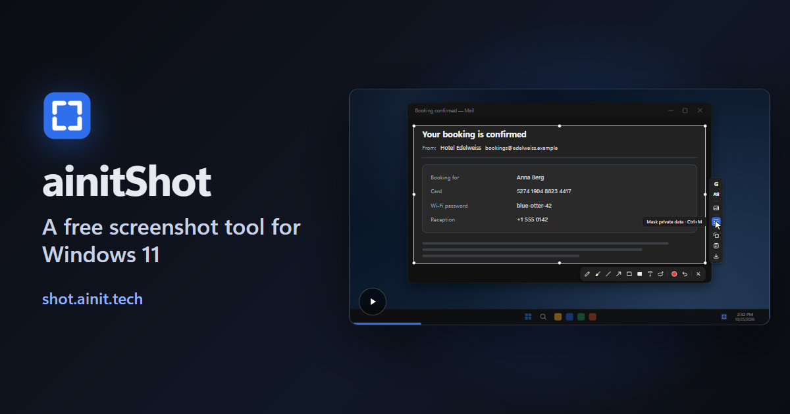

**English** · [Русский](README.ru.md) · [中文](README.zh.md) · [Español](README.es.md) · [Français](README.fr.md) · [العربية](README.ar.md)

# ainitShot

A free, open-source screenshot program for Windows. A key freezes the screen: take a window or a part of it, draw on it, mask what is private, and copy it or its text, save it, or ask Google's AI about it.

**[Download for Windows](https://shot.ainit.tech/get)** · [Site](https://shot.ainit.tech) · [Documentation](docs/README.md)

## What it does

- **Ask Google's AI about the screenshot** — <kbd>G</kbd>. AI Mode says who or what is in the picture, and the conversation opens next to the selection, to ask further. A loop of the magic pencil shows the AI what to look at.
- **Ask aloud** — hold <kbd>G</kbd>, say your question and let go: it goes with the picture.
- **Translate what you see** — <kbd>T</kbd>. The translation alone comes in a card next to the selection, in your language.
- **Search by image** — <kbd>I</kbd>. Google Images finds where the picture comes from and where else it is, exact matches first.
- **Mask private data** — <kbd>Ctrl</kbd>+<kbd>M</kbd>. Keys, passwords, card and account numbers, e-mail addresses, phone numbers and IP addresses are covered at once; OpenAI Privacy Filter, a model that runs on your computer, finds names, addresses, dates and links too. Nothing leaves the computer for it.
- **Copy the text from the picture** — <kbd>Ctrl</kbd>+<kbd>Shift</kbd>+<kbd>C</kbd>. The text recognition built into Windows reads it on your computer and puts it into the clipboard.
- **Magic pencil** — <kbd>M</kbd>. Circle something roughly, and get a neat oval or rectangle.
- **And all the usual drawing tools:** pencil, brush, line, arrow, rectangle, filled rectangle and text, each on its own key. Anything drawn can be moved, reshaped or rewritten afterwards, and <kbd>Ctrl</kbd>+<kbd>Z</kbd> undoes any change.
- **Copy or save** — <kbd>Ctrl</kbd>+<kbd>C</kbd> puts the screenshot into the clipboard, <kbd>Ctrl</kbd>+<kbd>S</kbd> saves it as a PNG file in Pictures\Screenshots.

## Your screenshot stays yours

- **On your computer:** drawing, masking and copying the text. They send nothing anywhere. The masking model, about 950 MB, downloads once by itself in the background; until it is there, masking finds everything but names, addresses, dates and links.
- **To Google, only when you ask:** the screenshot goes to Google's AI Mode or Google Images only from <kbd>G</kbd>, <kbd>T</kbd> or <kbd>I</kbd>, in the program's own window, as from a browser. Asked aloud, your voice goes to Google's speech recognition too; the microphone is on only while the key is held. To answer at once, the program keeps AI Mode loaded in its hidden window; your screenshot goes there only when you ask.
- **No accounts and no cloud of ours.** Signing in to Google in the program's window is up to you: Google then asks less often whether you're a robot, and AI Mode keeps your conversations. The only server of ours the program talks to is shot.ainit.tech, for updates, which come signed.

## And also

- **Print Screen**, or keys of your own, chosen on the first start; the program suggests <kbd>Alt</kbd> with the key left of <kbd>1</kbd>, for a screenshot with the left hand alone. Pressed again while the screen is frozen, the key starts the selection over.
- **50 languages**, the six of the UN and 44 more, chosen on the first start with a tile and a flag for each.
- **Settings in one window with a search**, and in a text file with comments that you can edit by hand. The query buttons, their questions and their keys are yours to change.
- Written in Rust; it waits in the background for the key. For Windows 11, 64-bit; it hasn't been tried on Windows 10.

## License, name and logo

ainitShot is free software under the GNU General Public License, version 3 or later ([LICENSE](LICENSE)): you may use, study, change and pass it on. The name ainitShot and its logo are not covered by the license: a fork, or any changed version you pass on, goes by another name and with another logo, so that nobody takes it for ainitShot.

## Reporting a problem

- **A bug:** open an issue at https://github.com/ainit-tech/shot/issues. Say what you did, what you expected and what happened instead, and give the program's version (Settings → About) and your version of Windows. A screenshot helps; make sure nothing private is on it.
- **A vulnerability:** don't describe it in an issue, where everyone can read it. Open an issue titled "Security contact" without any details, and we'll agree on a private way for you to send them.

## What we accept

- Bug reports.
- Fixes of translations: a wrong or clumsy word in any of the 50 languages, in an issue or as a pull request to `src/locales/<code>.json`. Most of the translations are machine-made and haven't been read by native speakers yet.

Changes to the code come later: we don't take them yet.

## Where it is developed

Development happens on SourceCraft ([sourcecraft.dev/ainit-tech/shot](https://sourcecraft.dev/ainit-tech/shot)); this repository on GitHub is its mirror, and issues are welcome here.
