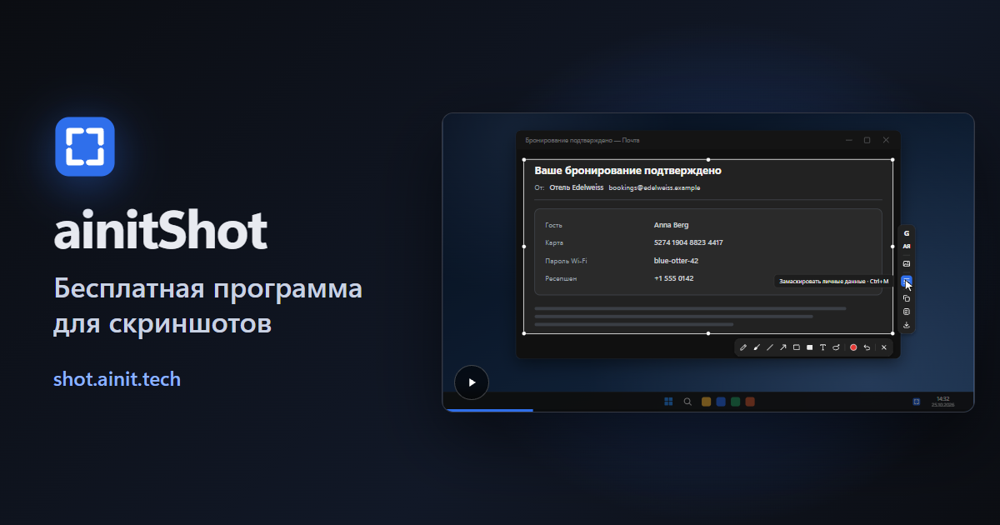

[English](README.md) · **Русский** · [中文](README.zh.md) · [Español](README.es.md) · [Français](README.fr.md) · [العربية](README.ar.md)

# ainitShot

Бесплатная программа с открытым кодом для снимков экрана в Windows. Клавиша замораживает экран: выдели окно или любую его часть, рисуй прямо на снимке, замаскируй личное — а потом скопируй снимок или его текст, сохрани его или спроси о нём ИИ Google.

**[Скачать для Windows](https://shot.ainit.tech/ru/get)** · [Сайт](https://shot.ainit.tech/ru) · [Документация](docs/ru/README.md)

## Что умеет

- **Спросить ИИ Google о снимке** — <kbd>G</kbd>. Режим ИИ скажет, кто или что на картинке, а разговор откроется рядом с выделением, чтобы спрашивать дальше. Петля волшебного карандаша покажет ИИ, куда смотреть.
- **Спросить голосом** — зажми <kbd>G</kbd>, скажи вопрос и отпусти: он уйдёт вместе с картинкой.
- **Перевести то, что видишь** — <kbd>T</kbd>. Рядом с выделением появится карточка с одним только переводом на твой язык.
- **Поиск по картинке** — <kbd>I</kbd>. Google Картинки найдут, откуда картинка и где она ещё есть, — сначала точные совпадения.
- **Замаскировать личные данные** — <kbd>Ctrl</kbd>+<kbd>M</kbd>. Ключи, пароли, номера карт и счетов, почта, телефоны и IP-адреса закрываются сразу, а OpenAI Privacy Filter — модель, которая работает на твоём компьютере, — находит ещё имена, адреса, даты и ссылки. Снимок для этого никуда не уходит.
- **Скопировать текст с картинки** — <kbd>Ctrl</kbd>+<kbd>Shift</kbd>+<kbd>C</kbd>. Распознавание текста, встроенное в Windows, читает его на твоём компьютере и кладёт в буфер обмена.
- **Волшебный карандаш** — <kbd>M</kbd>. Обведи что-нибудь небрежно — получится ровный овал или прямоугольник.
- **И все привычные инструменты рисования:** карандаш, кисть, линия, стрелка, прямоугольник, закрашенный прямоугольник и надпись, у каждого своя клавиша. Всё нарисованное можно потом передвинуть, поправить или переписать, а <kbd>Ctrl</kbd>+<kbd>Z</kbd> отменяет любое изменение.
- **Скопировать или сохранить** — <kbd>Ctrl</kbd>+<kbd>C</kbd> кладёт снимок в буфер обмена, <kbd>Ctrl</kbd>+<kbd>S</kbd> сохраняет его файлом PNG в «Изображения\Снимки экрана».

## Снимок остаётся твоим

- **На твоём компьютере:** рисование, маскирование и копирование текста. Они ничего никуда не отправляют. Модель для маскирования, около 950 МБ, один раз скачивается сама в фоне; пока её нет, маскирование находит всё, кроме имён, адресов, дат и ссылок.
- **В Google — только когда попросишь:** снимок уходит в режим ИИ Google или в Google Картинки только по <kbd>G</kbd>, <kbd>T</kbd> или <kbd>I</kbd>, в собственном окне программы, как из браузера. Если спрашиваешь голосом, голос тоже уходит в распознавание речи Google; микрофон включён, только пока клавиша зажата. Чтобы отвечать сразу, программа держит режим ИИ загруженным в своём скрытом окне; снимок попадает туда, только когда попросишь.
- **Без аккаунтов и без нашего облака.** Входить ли в Google в окне программы — решать тебе: со входом Google реже спрашивает, не робот ли ты, а режим ИИ сохраняет разговоры. Из наших серверов программа обращается только к shot.ainit.tech — за обновлениями, и они приходят подписанными.

## А ещё

- **Print Screen** или свои клавиши, выбранные при первом запуске; программа советует <kbd>Alt</kbd> и клавишу слева от <kbd>1</kbd> — снимок одной левой рукой. Нажми клавишу ещё раз, пока экран заморожен, — и выберешь заново.
- **50 языков:** шесть языков ООН и ещё 44; при первом запуске язык выбирают по плитке с флагом.
- **Настройки в одном окне с поиском** и в текстовом файле с комментариями, который можно править вручную. Кнопки запросов, их вопросы и клавиши можно менять.
- Написана на Rust и ждёт клавишу в фоне. Для Windows 11, 64-бит; на Windows 10 не проверялась.

## Лицензия, название и логотип

ainitShot — свободная программа под GNU General Public License версии 3 или более поздней ([LICENSE](LICENSE)): её можно использовать, изучать, менять и передавать другим. Название ainitShot и логотип лицензия не покрывает: форк или любая изменённая версия, которую передают другим, выходит под другим названием и с другим логотипом, чтобы её не приняли за ainitShot.

## Как сообщить о проблеме

- **Ошибка:** открой issue на https://github.com/ainit-tech/shot/issues. Опиши шаги, которые к ней привели, что должно было получиться и что вышло на самом деле, и укажи версию программы (Настройки → О программе) и версию Windows. Снимок экрана поможет; проверь, что на нём нет ничего личного.
- **Уязвимость:** не описывай её в issue, где её прочтут все. Открой issue с заголовком «Security contact» без подробностей, и мы договоримся, как передать их так, чтобы их не видел никто другой.

## Что мы принимаем

- Сообщения об ошибках.
- Исправления переводов: неверное или неуклюжее слово на любом из 50 языков — в issue или пул-реквестом в `src/locales/<код>.json`. Большинство переводов сделаны машиной, и носители языка их ещё не читали.

Изменения кода — позже: пока мы их не принимаем.

## Где идёт разработка

Разработка идёт на SourceCraft ([sourcecraft.dev/ainit-tech/shot](https://sourcecraft.dev/ainit-tech/shot)); этот репозиторий на GitHub — его зеркало, и issues здесь тоже принимаются.
