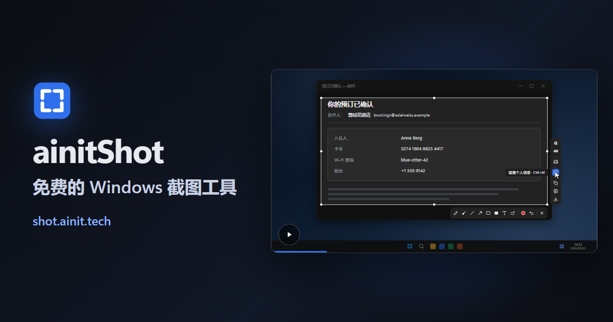

[English](README.md) · [Русский](README.ru.md) · **中文** · [Español](README.es.md) · [Français](README.fr.md) · [العربية](README.ar.md)

# ainitShot

免费、开源的 Windows 截图程序。按一个键冻结屏幕：选取一个窗口或其中任意部分，在上面绘图、遮盖个人信息，然后复制截图或其中的文字、保存它，或就它向 Google AI 提问。

**[下载 Windows 版](https://shot.ainit.tech/zh/get)** · [网站](https://shot.ainit.tech/zh) · [文档（英文）](docs/en/README.md)

## 它能做什么

- **就截图向 Google AI 提问** — <kbd>G</kbd>。Google AI 模式会告诉你图片里是谁或什么，对话在选区旁打开，可以继续追问。用魔法铅笔圈一圈，就能告诉 AI 该看哪里。
- **用语音提问** — 按住 <kbd>G</kbd>，说出问题，然后松开：问题会连同图片一起发送。
- **翻译你看到的内容** — <kbd>T</kbd>。选区旁的卡片里只显示译文，译成你的语言。
- **以图搜索** — <kbd>I</kbd>。Google 图片会找出图片来自哪里、还出现在哪里，先列出完全匹配的结果。
- **遮盖个人信息** — <kbd>Ctrl</kbd>+<kbd>M</kbd>。密钥、密码、卡号和银行账号、邮箱地址、电话号码以及 IP 地址会立即被盖住；OpenAI Privacy Filter 是一个在你的电脑上运行的模型，还能找出姓名、地址、日期和链接。截图不会因此离开你的电脑。
- **复制图片中的文字** — <kbd>Ctrl</kbd>+<kbd>Shift</kbd>+<kbd>C</kbd>。Windows 内置的文字识别在你的电脑上读取文字，并放进剪贴板。
- **魔法铅笔** — <kbd>M</kbd>。随手圈一圈，就会变成整齐的椭圆或矩形。
- **以及所有常用的绘图工具：** 铅笔、画笔、直线、箭头、矩形、实心矩形和文字，每种都有自己的按键。画好的内容之后都能移动、改变形状或改写，<kbd>Ctrl</kbd>+<kbd>Z</kbd> 可以撤销任何更改。
- **复制或保存** — <kbd>Ctrl</kbd>+<kbd>C</kbd> 把截图放进剪贴板，<kbd>Ctrl</kbd>+<kbd>S</kbd> 把它保存为 PNG 文件，存到“图片\屏幕截图”。

## 截图始终属于你

- **在你的电脑上完成：** 绘图、遮盖和复制文字。它们不会向任何地方发送任何内容。遮盖用的模型约 950 MB，会在后台自动下载一次；下载完成之前，遮盖能找出除姓名、地址、日期和链接以外的一切。
- **只在你要求时才发往 Google：** 只有按下 <kbd>G</kbd>、<kbd>T</kbd> 或 <kbd>I</kbd>，截图才会在程序自己的窗口中发往 Google AI 模式或 Google 图片，就像从浏览器发送一样。用语音提问时，你的声音也会发往 Google 的语音识别；只有按住按键时麦克风才会打开。为了立即回答，程序会在隐藏窗口中预先加载 AI 模式；只有在你提问时，截图才会发到那里。
- **无需帐号，不经我们的云端。** 是否在程序窗口中登录 Google 由你决定：登录后，Google 会较少询问你是不是机器人，AI 模式也会保存你的对话。程序唯一联系的我们的服务器是 shot.ainit.tech，用于获取更新，更新都带有签名。

## 此外

- **PrtSc**，或首次启动时选择的你自己的按键；程序推荐 <kbd>Alt</kbd> 加 <kbd>1</kbd> 左边的键，只用左手就能截图。屏幕冻结时再按一次该键，就能重新选择。
- **50 种语言**：联合国的六种语言和另外 44 种，首次启动时选择，每种语言都有一块带国旗的磁贴。
- **一个带搜索的设置窗口**，外加一个带注释、可以手动编辑的文本文件。查询按钮、它们的问题和按键都可以修改。
- 用 Rust 编写，在后台等待按键。适用于 64 位 Windows 11；尚未在 Windows 10 上试过。

## 许可证、名称和标志

ainitShot 是自由软件，采用 GNU 通用公共许可证第 3 版或更高版本（[LICENSE](LICENSE)）：你可以使用、研究、修改和传播它。名称 ainitShot 及其标志不在许可证范围内：分支或你传播的任何修改版本须使用其他名称和标志，以免被误认为 ainitShot。

## 报告问题

- **错误：** 在 https://github.com/ainit-tech/shot/issues 提交 issue。说明你做了什么、期望什么、实际发生了什么，并写明程序版本（设置 → 关于）和 Windows 版本。附上截图会有帮助；请确认截图中没有私人信息。
- **安全漏洞：** 不要在 issue 中描述，因为所有人都能看到。请提交一个标题为 “Security contact” 且不含任何细节的 issue，我们会和你商定私下发送细节的方式。

## 我们接受什么

- 错误报告。
- 翻译修正：50 种语言中任何一种里用错或别扭的词，可以提交 issue，或向 `src/locales/<代码>.json` 提交拉取请求。大部分翻译是机器翻译，尚未经过母语者审阅。

代码修改以后再说：目前我们还不接受。

## 在哪里开发

开发在 SourceCraft 上进行（[sourcecraft.dev/ainit-tech/shot](https://sourcecraft.dev/ainit-tech/shot)）；GitHub 上的这个仓库是它的镜像，也欢迎在这里提交 issue。
